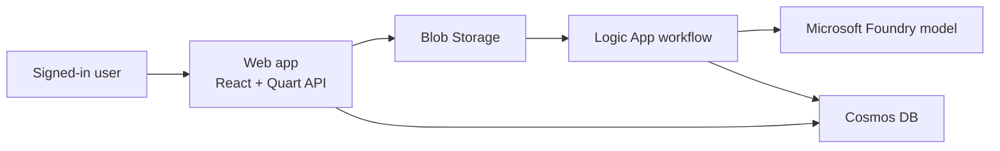

# AI Solution Starter

A ready-made Azure baseline for AI document apps. It deploys a web app
where users upload PDFs, an AI workflow that processes them, and everything
around it: private networking, managed identity, sign-in and monitoring.

The PDF demo is small on purpose. Keep the infrastructure and replace the
demo with your own app.



## Choose your path

| I want to... | Start here |
| --- | --- |
| Deploy the demo to Azure, step by step | [Deploy the demo](docs/quickstarts/deploy-demo.md) |
| Deploy with private endpoints, Foundry and Document Intelligence | [Private Foundry + Document Intelligence](docs/quickstarts/deploy-private-foundry-docintel.md) |
| Deploy from GitHub Actions | [Deploy with GitHub Actions](docs/quickstarts/deploy-github-actions.md) |
| See all deployment scenarios | [Quick starts](docs/quickstarts/README.md) |
| Try the code without an Azure subscription | [Run tests without Azure](docs/quickstarts/run-tests-without-azure.md) |
| Understand how it fits together | [Architecture](docs/concepts/architecture.md) |
| Look up a setting | [Configuration reference](docs/reference/configuration.md) |
| Replace the demo with my own app | [Customize the app](docs/how-to/customize-the-app.md) |
| Contribute | [Development](docs/contributing/development.md) |

New to Azure or infrastructure as code? Start with
[before you start](docs/quickstarts/before-you-start.md), then
[deploy the demo](docs/quickstarts/deploy-demo.md). All the documentation is
listed in the [documentation hub](docs/README.md).

## What you get

- **Web app:** React frontend and Quart API in one container on App Service,
  with Microsoft Entra sign-in.
- **Processing:** a Logic Apps Standard workflow that sends each PDF to a
  Microsoft Foundry model and saves a structured result.
- **Data:** Blob Storage for files and Cosmos DB for work items.
- **Security:** private endpoints and a VNet by default, managed identity
  instead of keys, and least-privilege role assignments.
- **Monitoring:** Application Insights and Log Analytics.
- **Optional:** standalone Azure OpenAI and Document Intelligence, new or
  existing.
- **Deployment:** Bicep with the Azure Developer CLI (azd), plus a GitHub
  Actions workflow.

The app and infrastructure are tested locally and in CI without Azure. A
full deployment hasn't been validated end to end; see
[known limitations](docs/concepts/known-limitations.md) before you rely on
it.

## Repository layout

```text
app/frontend/   React, TypeScript and Vite
app/backend/    Quart API and the production container
app/agent/      Logic App workflow and prompts
infra/          Bicep templates (protected baseline)
scripts/        Deployment hooks, deploy and access scripts, checks
docs/           Documentation
tests/          Shared fixtures and synthetic sample data
.github/        CI and deployment workflows
```

## Contributing

See [CONTRIBUTING.md](CONTRIBUTING.md). Never commit real documents,
credentials, tenant or subscription IDs, or copied proprietary material;
see [source sanitization](docs/contributing/sanitization.md).

## License

[MIT](LICENSE)
