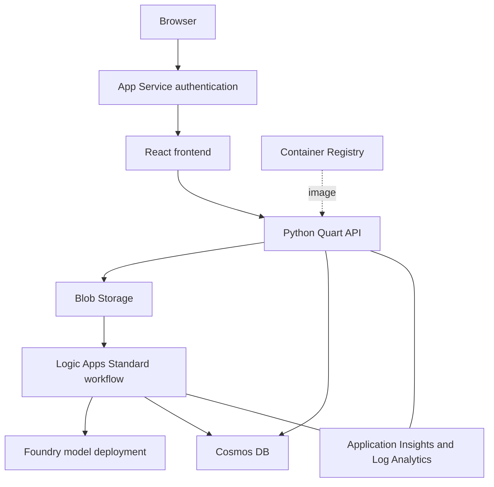
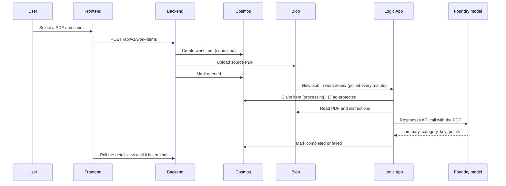

# Architecture

The starter is a small, complete AI application. A signed-in user uploads a
PDF, a workflow asks a Foundry model to summarize it, and the user sees the
result. Each part is meant to be replaced with your own use case while you
keep the secure Azure foundation.

## Components



| Component | Folder | What it does |
| --- | --- | --- |
| Frontend | [`app/frontend/`](../../app/frontend/) | React and Vite UI. It is built into the backend container, so browser calls stay same-origin. |
| Backend | [`app/backend/`](../../app/backend/) | Quart API. It authenticates the user, validates and stores PDFs, and serves the frontend. |
| Workflow | [`app/agent/`](../../app/agent/) | Logic Apps Standard workflow. It processes queued PDFs with the Foundry model. |
| Infrastructure | [`infra/`](../../infra/) | Bicep for every Azure resource. Treat it as a protected baseline. |
| Scripts | [`scripts/`](../../scripts/) | Sign-in setup, deployment, access and validation helpers |
| Automation | [`.github/`](../../.github/) | CI checks and the manual Azure deployment workflow |

The Azure resources are listed in the [resource reference](../reference/resources.md).

## How a document is processed



- The API accepts PDFs up to 20 MiB. A required `Idempotency-Key` header stops
  a retried request from creating a second work item. See the
  [API reference](../reference/api.md).
- The workflow starts when a new PDF appears under `work-items/` in the
  `inputs` container. It checks for new blobs every minute and runs one item
  at a time.
- The workflow reads its prompts (`system.md` and `processing.md`) from the
  `instructions` Blob container. To change behavior you can edit the prompts
  without changing code.
- The model is called with the Responses API, a PDF file input and a
  structured-output schema. A replacement model must support all three.
- The frontend polls only an open detail view that is not yet finished.

### Work item lifecycle

```text
submitted -> queued -> processing -> completed
                               \-> failed
```

| Transition | Owner |
| --- | --- |
| Create `submitted` | Backend |
| `submitted` → `queued` | Backend |
| `submitted` → `failed` | Backend, when the upload fails |
| `queued` → `processing` | Logic App |
| `processing` → `completed` or `failed` | Logic App |

`completed` and `failed` are terminal. Every state change uses the Cosmos DB
ETag, so two writers can't overwrite each other.

## Security boundaries

- **User identity.** App Service authentication (Easy Auth) signs the user in
  with Microsoft Entra ID. The backend trusts only the identity header that
  App Service adds. See [Identity and access](identity-and-access.md).
- **Ownership.** Every read and write is scoped to the signed-in owner.
  Responses never expose owner IDs, Blob paths, partition values,
  idempotency hashes or ETags.
- **No keys.** The app, the workflow and the deployment use managed identities
  and Azure RBAC. Storage shared keys, public Blob access and the Container
  Registry admin user are turned off.
- **Private by default.** The default deployment puts every data and AI
  service behind private endpoints in a generated virtual network. See
  [Networking](networking.md).

## Optional services

Standalone Azure OpenAI and Document Intelligence can be provisioned for your
own extensions. The sample workflow uses neither: it calls only the Foundry
model deployment. See
[Choose AI services and models](../how-to/choose-ai-services-and-models.md).
