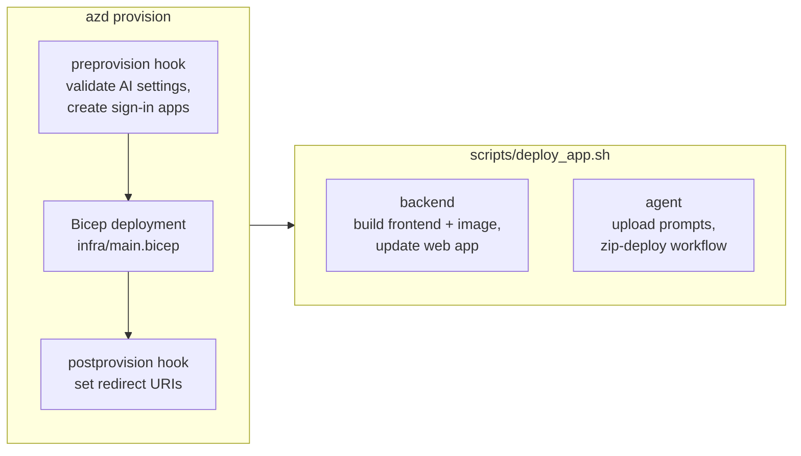
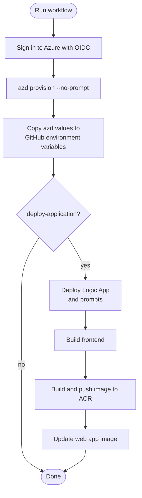

# How deployment works

There are two separate steps:

1. **Provision** the Azure resources with the Azure Developer CLI (`azd`) and
   the Bicep in [`infra/`](../../infra/).
2. **Deploy the app** (the backend container and the Logic App workflow) with
   [`scripts/deploy_app.sh`](../../scripts/deploy_app.sh).

`azd up` and `azd deploy` do **not** deploy the app code: [`azure.yaml`](../../azure.yaml)
declares no `services`. After provisioning, the web app runs a placeholder
image until you run the deploy script.

## azd environments

An azd environment is a named set of settings stored in
`.azure/<environment-name>/.env` on your machine. `azd env new` creates one,
and `azd env set NAME value` adds a setting. `azd provision` passes the
settings to Bicep through
[`infra/main.parameters.json`](../../infra/main.parameters.json), and then
writes the deployment outputs (resource names, endpoints) back into the
same file.

- Every setting and its default is listed in the
  [configuration reference](../reference/configuration.md).
- The `.azure/` folder is ignored by Git. It can contain secrets, such as the
  sign-in app secrets, so don't share or commit it.
- Use one environment per deployment target. See
  [Manage multiple environments](../how-to/manage-multiple-environments.md).

## What `azd provision` does

1. **`preprovision` hook** ([`scripts/auth_init.sh`](../../scripts/auth_init.sh)):
   - Validates the AI service settings with
     `scripts/validate_ai_service_config.py --from-azd --check-azure`.
   - If `AZURE_USE_AUTHENTICATION=true`, creates or reuses two Microsoft Entra
     app registrations (the API and the browser client). It stores their IDs and
     secrets in the azd environment.
2. **Bicep deployment** at subscription scope. It creates the resource group
   (`rg-<environment-name>` by default) and everything in it. This step takes
   most of the time. A private deployment can take 20 minutes or more.
3. **`postprovision` hook** ([`scripts/auth_update.sh`](../../scripts/auth_update.sh)):
   adds the deployed site and local development addresses as sign-in
   redirect URIs.

The hooks read settings with `azd env get-value`. Exported shell variables
don't change their behavior, so use `azd env set`.

## What `deploy_app.sh` does

| Command | Steps |
| --- | --- |
| `./scripts/deploy_app.sh backend` | Builds the frontend, builds the container image in Azure Container Registry with `az acr build`, and points the web app at the new image |
| `./scripts/deploy_app.sh agent` | Uploads `system.md` and `processing.md` to the `instructions` container, then zip-deploys the workflow to the Logic App |
| `./scripts/deploy_app.sh all` | Both, backend first |

The script reads resource names from the selected azd environment. Your
machine must be able to reach Storage, the registry and the app's deployment
endpoint, so in private mode you need network access first. See
[Access a private deployment](../how-to/access-a-private-deployment.md).

## Deploying with GitHub Actions

[`.github/workflows/azure-dev.yml`](../../.github/workflows/azure-dev.yml)
is run manually from the **Actions** tab.

- **Sign-in** uses OpenID Connect (OIDC) federation, so no Azure password is
  stored for provisioning.
- **Configuration** comes from the variables of the selected GitHub
  environment. The workflow creates a matching azd environment on the runner.
- **Sign-in apps** are not created in CI: the authentication hooks run only
  when `AZURE_USE_AUTHENTICATION=true` is in the azd environment, and the
  workflow doesn't pass it. Create the apps once from your machine and store
  their IDs and secrets in GitHub. The
  [GitHub Actions quick start](../quickstarts/deploy-github-actions.md#2-create-the-sign-in-apps)
  shows how.
- **Temporary firewall rules.** Application deployment briefly opens the Logic
  App, registry and web app to the runner's IP address and removes the rules
  afterwards.

GitHub-hosted runners can't reach private Storage, so app deployment from
the workflow doesn't work yet for the default private setup. Provision with
the workflow and deploy the app from a machine or self-hosted runner that
has network access. The gaps are tracked in [planning](../planning/README.md).

All inputs, variables and secrets are listed in the
[GitHub workflows reference](../reference/github-workflows.md).

## What is not automated

- **Rollback.** Nothing rolls back the image, workflow, prompts, sign-in apps
  and infrastructure together. Redeploying an old image doesn't roll back the
  rest.
- **Model and region checks.** Provisioning fails if your region lacks quota
  for the model. Check the
  [prerequisites](../quickstarts/before-you-start.md) first.
- **End-to-end testing.** Automated tests run locally without Azure. Confirm a
  deployment by uploading a synthetic PDF, as described in the
  [demo quick start](../quickstarts/deploy-demo.md#4-try-it).
