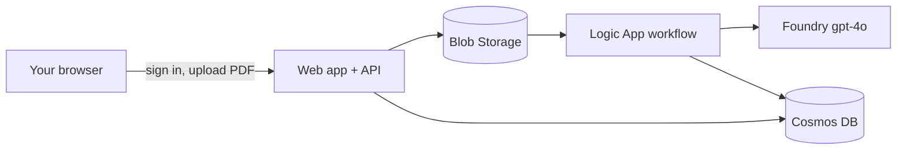

# Deploy the demo

Deploy the complete sample from your machine: a web app where you upload a
PDF and an AI workflow summarizes it. This is the recommended first
deployment.

**You will need:** everything in [before you start](before-you-start.md).

## What you get



All services talk to each other over **private endpoints**. Your own public
IP address is added to an allowlist, so you can open the site and deploy
code from your machine. Everyone else is blocked.

## 1. Create an environment

An azd *environment* is a named set of settings stored in `.azure/<name>/`.

```bash
azd env new starter-demo
azd env set AZURE_LOCATION eastus2
azd env set AZURE_USE_AUTHENTICATION true
azd env set AZURE_ALLOWED_IPS "$(curl -fsS https://api.ipify.org)"
```

| Setting | Why |
| --- | --- |
| `AZURE_LOCATION` | Region for all resources. Use the one you picked. |
| `AZURE_USE_AUTHENTICATION` | Creates the Entra sign-in apps. Without it the site returns 401. |
| `AZURE_ALLOWED_IPS` | Lets your machine through the firewalls. Check that it printed an IPv4 address. |

Everything else uses defaults. See [configuration](../reference/configuration.md)
for all the settings.

## 2. Create the Azure resources

```bash
azd provision
```

Choose your subscription if prompted. This takes 20 to 40 minutes.
Before creating resources, azd runs a hook that checks your AI settings and
creates the sign-in app registrations. Afterward, another hook sets their
redirect URLs.

## 3. Deploy the code

```bash
./scripts/deploy_app.sh all
```

This builds the frontend, builds the container image in Azure Container
Registry, points the web app at it, uploads the AI instructions to Storage,
and deploys the Logic App workflow. It takes about 5 to 10 minutes.

> `azd provision` only creates infrastructure. `azd deploy` and `azd up` do
> **not** deploy this app. Use the script.

If you see `403` errors right after provisioning, wait a few minutes for
role assignments to take effect and run the script again.

## 4. Try it

```bash
azd env get-value BACKEND_URI
```

Open the URL, sign in, and upload a PDF. To create a harmless test PDF:

```bash
python3 scripts/generate_sample_pdf.py tests/sample-data/generated/hello-world.pdf
```

The item moves from **queued** to **processing** to **completed** and shows a
summary, category and key points. The first run can take a minute while the
Logic App warms up.

## 5. Clean up

```bash
azd down --purge
```

This deletes the resource group and purges the AI resources. The Entra app
registrations are not deleted. See [clean up](../how-to/clean-up.md).

## If something goes wrong

| Problem | Fix |
| --- | --- |
| `403` or "not authorized by network rules" | Your IP changed. Run `azd env set AZURE_ALLOWED_IPS "$(curl -fsS https://api.ipify.org)"` then `azd provision` again. |
| Quota or `InsufficientQuota` error | Pick another region or [use a smaller model capacity](../how-to/choose-ai-services-and-models.md). |
| Item stays **queued** | The workflow was not deployed. Run `./scripts/deploy_app.sh agent`. |
| Anything else | See [troubleshoot](../how-to/troubleshoot.md). |

## Next

- [Turn off your IP allowlist and go fully private](../how-to/access-a-private-deployment.md)
- [Run the same deployment from GitHub Actions](deploy-github-actions.md)
- [Replace the PDF sample with your own app](../how-to/customize-the-app.md)
