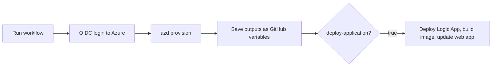

# Deploy with GitHub Actions

Provision the infrastructure (and optionally the app) from the
**Deploy to Azure** workflow instead of your machine. You set it up once;
after that anyone with access to the repository can run it.

**You will need:** everything in [before you start](before-you-start.md),
admin access to the GitHub repository (or your fork), and permission to
create app registrations.

## How it works



The workflow signs in with **OpenID Connect (OIDC)**, so there is no Azure
password stored for provisioning. The settings come from **GitHub environment
variables**, which play the same role as `azd env set` does locally.

## 1. Create a deployment identity

This identity is what GitHub uses to sign in to Azure. Replace the
placeholders, then run:

```bash
GH_REPO="<owner>/<repo>"
SUBSCRIPTION_ID="$(az account show --query id -o tsv)"

APP_ID=$(az ad app create --display-name "starter-github-deploy" --query appId -o tsv)
az ad sp create --id "$APP_ID"

az ad app federated-credential create --id "$APP_ID" --parameters "{
  \"name\": \"github-dev\",
  \"issuer\": \"https://token.actions.githubusercontent.com\",
  \"subject\": \"repo:${GH_REPO}:environment:dev\",
  \"audiences\": [\"api://AzureADTokenExchange\"]
}"

az role assignment create --assignee "$APP_ID" --role Owner \
  --scope "/subscriptions/${SUBSCRIPTION_ID}"
```

`Owner` is needed because the template creates role assignments. You can use
**Contributor** plus **User Access Administrator** instead.

## 2. Create the sign-in apps

The workflow does not create Entra app registrations, so create them once
from your machine:

```bash
azd env new starter-gh
azd env set AZURE_LOCATION eastus2
azd env set AZURE_USE_AUTHENTICATION true
azd env set AZURE_AUTH_TENANT_ID "$(az account show --query tenantId -o tsv)"
./scripts/auth_init.sh
```

Then print the values you need for step 3. The secrets print to your
terminal, so do not share the output:

```bash
for v in AZURE_SERVER_APP_ID AZURE_CLIENT_APP_ID AZURE_AUTH_TENANT_ID \
         AZURE_SERVER_APP_SECRET AZURE_CLIENT_APP_SECRET; do
  echo "$v=$(azd env get-value $v)"
done
```

## 3. Configure the GitHub environment

In GitHub, go to **Settings → Environments → New environment** and name it
`dev`. Add these:

**Variables**

| Name | Value |
| --- | --- |
| `AZURE_SERVICE_PRINCIPAL_CLIENT_ID` | `$APP_ID` from step 1 |
| `AZURE_TENANT_ID` | Your tenant ID |
| `AZURE_SUBSCRIPTION_ID` | Your subscription ID |
| `AZURE_ENV_NAME` | `starter-gh` |
| `AZURE_LOCATION` | `eastus2` |
| `AZURE_SERVER_APP_ID` | From step 2 |
| `AZURE_CLIENT_APP_ID` | From step 2 |
| `AZURE_AUTH_TENANT_ID` | From step 2 |

**Secrets**

| Name | Value |
| --- | --- |
| `AZURE_SERVER_APP_SECRET` | From step 2 |
| `AZURE_CLIENT_APP_SECRET` | From step 2 |
| `MANAGE_ENV_VARS_PAT` | A fine-grained personal access token for this repository with **Environments: read and write**. The workflow uses it to save outputs as variables. |
| `AZURE_SERVICE_PRINCIPAL_CLIENT_SECRET` | Only for deploying the app. Create one with `az ad app credential reset --id "$APP_ID" --append --query password -o tsv`. Used to push to the container registry. |

To change any other setting, add a variable with the same name as in
[configuration](../reference/configuration.md). For example, add
`USE_DOCUMENT_INTELLIGENCE` = `new`.

## 4. Run the workflow: provision

In GitHub, go to **Actions → Deploy to Azure → Run workflow**. Choose `dev`
and leave **Deploy application packages** unchecked.

When it finishes, the `dev` environment has new variables such as
`AZURE_RESOURCE_GROUP` and `BACKEND_URI`.

## 5. Update the sign-in redirect URL

Point the sign-in app at the new site:

```bash
azd env set BACKEND_URI "<BACKEND_URI from the GitHub variables>"
./scripts/auth_update.sh
```

## 6. Deploy the app

The app deploy steps need network access to Storage. GitHub-hosted
runners cannot reach Storage when it is private, so choose one:

- **Simplest:** deploy from your machine. In the `starter-gh` environment,
  allow your IP and deploy:

  ```bash
  azd env set AZURE_ALLOWED_IPS "$(curl -fsS https://api.ipify.org)"
  azd provision
  ./scripts/deploy_app.sh all
  ```

  This targets the same resources because the environment name, region and
  subscription match. If you set extra variables in GitHub, set the same
  values locally with `azd env set` first.

- **From GitHub:** run the workflow again with **Deploy application
  packages** checked, using a
  [self-hosted runner](https://docs.github.com/actions/hosting-your-own-runners)
  that can reach the VNet.

See the [planning notes](../planning/README.md) for the fixes that would
let GitHub-hosted runners deploy the app.

## Clean up

```bash
azd env select starter-gh
azd down --purge
```

Also delete the `starter-github-deploy` app registration and the `dev`
environment's variables if you no longer need them.

## Next

- [Reference: what the workflows do](../reference/github-workflows.md)
- [Add a test or prod environment](../how-to/manage-multiple-environments.md)
- [Known limitations](../concepts/known-limitations.md)
